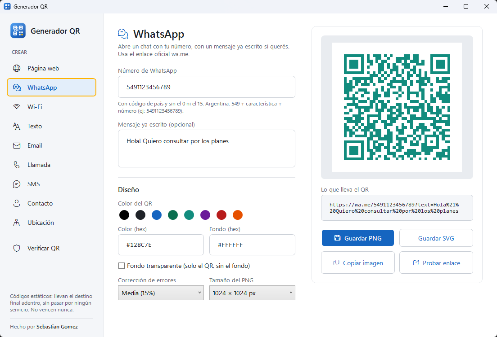
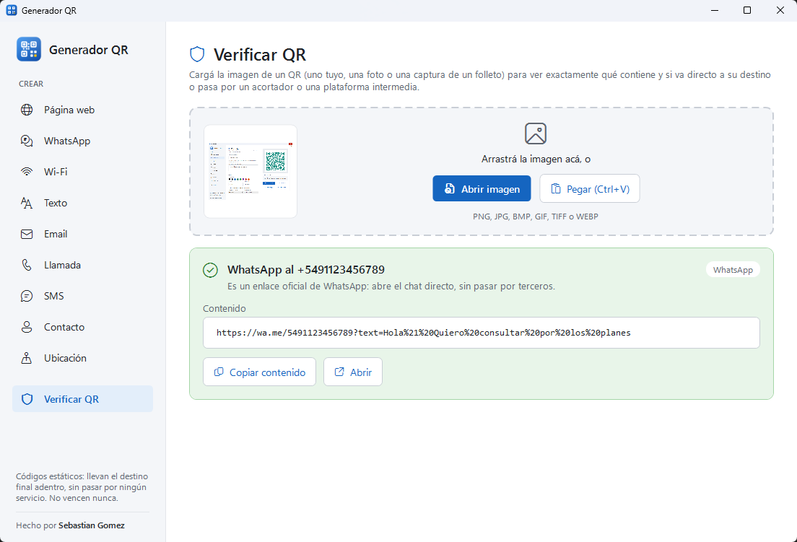

<div align="center">


# Generador QR

**Creá y verificá códigos QR estáticos: llevan el destino final adentro, sin acortadores ni plataformas intermedias. No vencen nunca.**


</div>

---

<p align="center">
  
</p>

## 🤔 ¿Por qué estático?

Muchos generadores online te dan un QR **dinámico**: el código apunta a *su* servidor (`qrco.de/…`, `bit.ly/…`) y de ahí te redirigen a tu página. Si ese servicio cierra, empieza a cobrar o cambia el destino, **tu QR impreso deja de funcionar**.

Los QR de esta app llevan **la dirección final adentro**. No dependen de nadie: funcionan hoy y dentro de 20 años.

## ✨ Funcionalidades

### Crear

| | |
|---|---|
| 🌐 **Página web** | La dirección tal cual. Si no escribís `https://`, lo agrega solo |
| 💬 **WhatsApp** | Abre un chat con tu número y un mensaje ya escrito, con el enlace oficial `wa.me` |
| 📶 **Wi-Fi** | Tus clientes se conectan escaneándolo, sin escribir la contraseña (WPA, WEP o abierta, también redes ocultas) |
| 📝 **Texto** | Cualquier texto, con tildes y ñ |
| ✉️ **Email** | Destinatario, asunto y mensaje listos para enviar |
| 📞 **Llamada** y 💌 **SMS** | El teléfono marcado o el mensaje listo |
| 👤 **Contacto** | Tarjeta (vCard) que el celular ofrece guardar en la agenda |
| 📍 **Ubicación** | Elegís el punto en un **mapa**: arranca donde estás, tocás, arrastrás el pin o buscás la dirección |

### Diseño y exportación

| | |
|---|---|
| 👀 **Vista previa en vivo** | El QR se actualiza mientras escribís, y ves exactamente el texto que lleva adentro |
| 🎨 **Colores** | Color del QR y del fondo, con aviso si hay poco contraste para que lo lea un celular |
| 🫥 **Fondo transparente** | Solo los módulos del QR, para ponerlo sobre tus diseños |
| 🖼️ **PNG** | De 512 a 4096 px, RGBA real (la transparencia funciona en CorelDRAW, Illustrator, Photoshop y Canva) y a 300 dpi |
| ✒️ **SVG** | Vectorial, nítido a cualquier tamaño, ideal para imprenta |
| 📋 **Copiar** | Directo al portapapeles para pegar donde quieras |
| 🔗 **Probar enlace** | Abre el destino para comprobarlo antes de imprimir |
| 🛡️ **Corrección de errores** | Baja, media, alta o máxima, según cuánto pueda ensuciarse o taparse el código |

### Verificar

<p align="center">
  
</p>

Abrí, arrastrá o pegá (`Ctrl+V`) la imagen de **cualquier** QR (uno tuyo, una foto o una captura de un folleto) y la app te dice:

- ✅ **Va directo**: el QR lleva la dirección final.
- ⚠️ **Pasa por un intermediario**: acortadores (bit.ly, tinyurl…), plataformas de QR dinámicos (qrco.de, me-qr, QR Tiger…) o redirecciones con `?url=`.
- ℹ️ **Qué es**: red Wi-Fi, contacto, ubicación, email, texto…

Lee varios QR en una misma imagen, códigos invertidos (claro sobre oscuro) y PNG transparentes.

## 📥 Instalación

Descargá **`GeneradorQR.exe`** del [último release](https://github.com/SbaGomez/GeneradorQR/releases/latest) y ejecutalo. Es un solo archivo, no necesita instalar nada (ni siquiera .NET).

> 🛡️ La primera vez Windows puede mostrar *"Windows protegió tu PC"*: tocá **Más información → Ejecutar de todas formas**.

> 📍 Para que el mapa arranque donde estás, la ubicación tiene que estar activada en **Configuración → Privacidad y seguridad → Ubicación**. El mapa necesita internet; los QR que generás no.

## 🛠️ Desarrollo

```powershell
dotnet run --project src/GeneradorQR.App   # abrir la app
dotnet test                                # correr los tests
```

### Generar el `.exe`

```powershell
dotnet publish src/GeneradorQR.App -c Release -r win-x64 --self-contained true `
  -p:PublishSingleFile=true -p:IncludeNativeLibrariesForSelfExtract=true `
  -p:EnableCompressionInSingleFile=true -p:DebugType=none -o publish
```

Queda un único `publish/GeneradorQR.exe`. El icono se regenera con `powershell -File tools/GenerarIcono.ps1`.

### 🗂️ Estructura

```
src/
├── GeneradorQR.Core/     Contenido de cada tipo de QR, generación (PNG/SVG), lectura y análisis
└── GeneradorQR.App/      Interfaz WPF (MVVM), mapa de ubicación
tests/
└── GeneradorQR.Core.Tests/   Tests xUnit, incluidos ida y vuelta generar → leer
tools/
└── GenerarIcono.ps1      Dibuja el icono de la app
```

### 🧰 Hecho con

- [QRCoder](https://github.com/codebude/QRCoder): codificación de los QR
- [ZXing.Net](https://github.com/micjahn/ZXing.Net): lectura de QR en imágenes
- [CommunityToolkit.Mvvm](https://github.com/CommunityToolkit/dotnet): MVVM
- [WebView2](https://developer.microsoft.com/microsoft-edge/webview2/) + [Leaflet](https://leafletjs.com) + [OpenStreetMap](https://www.openstreetmap.org): mapa de ubicación

---

<div align="center">

Hecho por **[Sebastian Gomez](https://sebastiangomez.com.ar)**

</div>
